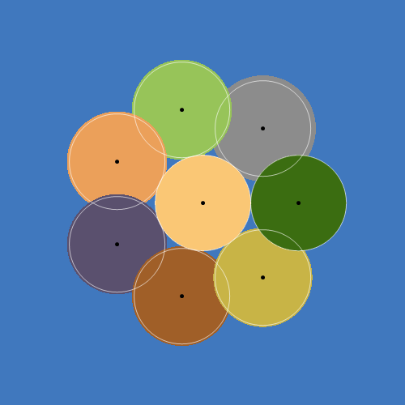

# 월드 생성 진화 기록

맵 생성 알고리즘을 단계마다 조건을 바꾸며 진화시킨 기록이다.

- 출발점은 2024년 `World.cpp`에 주석으로 남아 있던 생성기 초안이다(2024-10-14부터 주석, 실행된 적 없음). 무작위 중심, 최소 신장 트리 길, BFS 성장으로 되어 있었다. 각 단계는 그 코드를 새로 쓰지 않고 고쳐 나간다.
- 방사형 배치는 2024-10-10 코드의 구상(시작 각도 + 360° ÷ 바이옴 수)에서 왔다.
- 설계와 조건은 사용자(Cyphen)가 정했다. 단계마다 조건표에 값과 출처를 적는다.
- 구현은 AI와 협업했다.
- 측정은 AI가 작성한 도구([MeasureTool/WorldGen](../MeasureTool/README.md))로 했다. 도구는 생성기 안을 들여다보지 않고, 시드를 넣어 받은 성공 여부와 생성기가 채운 `worldMap`만 잰다. 아래 결과 수치는 모두 그 도구의 출력이다.
- 단계는 진화 순서다. 앞 단계에서 얻은 것을 이어받고 앞으로 돌아가지 않는다.

| 단계 | 바꾸는 조건 | 상태 |
|---|---|---|
| L1.0 | 규칙만으로 방사형 배치 (바이옴 8개, 균등 크기, 원, 등간격) | 완료 |
| L1.1 | 크기 배율 1 ± p | |
| L1.2 | 등간격 시작 각도 무작위 | |
| L1.3 | 바이옴 수 8 + 0~4 | |
| L1.4 | 방향 가중치 | |
| L2 | 원점 배치를 등간격에서 난수로 | |
| L3 | 월경지 없음 | |
| L4 | 쏠림 제어 | |
| B | 길을 중앙이 아닌 최인접 바이옴(MST)으로 | |

## L1.0 — 규칙만으로 방사형 월드가 생성된다

### 조건

| 항목 | 2024 초안 | L1.0 | 출처 |
|---|---|---|---|
| 맵 | 500 x 500칸 | 그대로 | 2024 코드 |
| 땅 | 70%, 몫 내림 | 35% 이상(87,500칸). 몫 = 땅 ÷ 8 올림 = 10,938칸 | 사용자 2026-10-19 |
| 바이옴 | 필수 8 + 무작위 0~4, 섞음 | 필수 8개만. 시작 바이옴(Spawn)이 첫째 | 2024 코드, 사용자 10-16 |
| 모양 | (BFS 마름모) | 원. 반지름 = √(몫 ÷ π), 약 59칸 | 사용자 10-19 |
| 시작 바이옴 중심 | 무작위 | 맵 중앙 | 사용자 10-16 |
| 외곽 중심 각도 | 무작위 | k x 360° ÷ 7, 시작 각도 0° | 2024-10-10 구상, 사용자 10-19 |
| 외곽 중심 거리 | 서로 맵 한 변의 10% 이상 | 시작 바이옴에 맞닿는 자리 (r시작 + r외곽) | 사용자 10-20 |
| 연결 (A) | 최소 신장 트리 간선 | 외곽 중심에서 중앙 쪽으로 직선을 긋다가 시작 바이옴 땅에 닿으면 멈춘다. 외곽 원점에서 중앙 원점까지 최단 경로가 두 바이옴의 땅이 된다 | 사용자 10-19~21 |
| 순서 | 길 전부 → 성장 전부 | 시작 바이옴 성장 → 외곽 길 전부 → 외곽을 하나씩 성장 (순차). 길을 성장보다 먼저 깐다 | 사용자 10-16·10-19 |
| 성장 | 큐 순서 BFS, 중심이 땅이면 멈춤 | 중심에 가까운 빈 칸부터(거리 제곱 순). 다른 바이옴 땅은 덮지도 지나가지도 않고, 자기 길은 지나간다 | 사용자 10-19·10-20 |
| 시드 | World 생성자의 `srand(time(0))` | 바깥(씬 진입 때 월드를 주입하는 쪽)이 시도할 때마다 새로 뽑아 생성기에 넘긴다. 다만 L1.0 규칙에는 난수가 없다 | 사용자 10-22 |
| 실패 | 없음 | 바이옴 하나라도 타일 수를 다 못 채우면 그 시도는 실패. 재생성을 요청한 뒤 시드를 다시 뽑는다. M번 모두 실패하면 최종 실패이고, 실패한 월드는 넣지 않는다 | 사용자 10-22, R19 |
| 잠정 (결정 전) | | M = 10 (근거 없음). 길 칸을 그 바이옴의 몫에 넣는다(땅과 몫이 정확히 맞도록). 길 모양은 2024 직선 긋기 그대로 | 잠정 U4, AI 제안 |

### 결과 (측정: [results/L1_0.txt](../MeasureTool/WorldGen/results/L1_0.txt))

| 항목 | 결과 |
|---|---|
| 생성 | 시드 1~10 모두 성공 |
| 같은 시드로 두 번 생성 | 칸 단위로 같다 |
| 시드와 무관한가 | 시드 1~10 모두 칸 단위로 같은 지도 |
| 땅 | 87,504칸, 35.00% (목표 87,500칸 이상 충족) |
| 몫 | 8개 모두 정확히 10,938칸 |
| 섬 (땅 덩어리) | 1 |
| 중앙 칸에서 땅만 밟아 닿는 칸 | 87,504 / 87,504 |
| A 보장 | 외곽 7개 모두 충족 |
| 월경지 / 내부 구멍 | 0 / 0 |
| 생성 시간 | 약 13 ms |

| 놓은 순서 | 바이옴 | 예상 원 밖 칸 | 시작 바이옴과 맞닿은 변 | 무게중심 각도 (규칙) | 무게중심 거리 (규칙 118.0) |
|---|---|---|---|---|---|
| 0 | Spawn | 25 | - | - | 0.1 |
| 1 | Forest | 26 | 7 | 0.0° (0.0°) | 118.0 |
| 2 | Savannah | 668 | 34 | 52.8° (51.4°) | 119.9 |
| 3 | Beechnut | 766 | 34 | 104.6° (102.9°) | 120.1 |
| 4 | Swamp | 802 | 38 | 156.3° (154.3°) | 120.0 |
| 5 | Desert | 837 | 39 | 207.7° (205.7°) | 120.1 |
| 6 | Grass | 823 | 35 | 259.3° (257.1°) | 120.3 |
| 7 | Rock | 1,445 | 56 | 309.1° (308.6°) | 124.0 |

지도: 바이옴 색, 흰 원 = 규칙에서 계산한 예상 모양, 검은 점 = 규칙상 원점

### 판단

- 2024 초안의 구조(바이옴 목록 → 몫 → 중심 → 길 → 성장)를 그대로 두고 버그와 조건만 고쳐, 규칙만으로 방사형 월드가 만들어진다. 규칙에 난수가 없어 시드가 달라도 같은 지도다.
- 이웃 외곽끼리는 원이 약 16칸 겹친다(원점 사이 약 102칸, 반지름 합 118칸). 순차 성장이라 뒤에 놓인 외곽일수록 앞 이웃에게 겹친 자리를 잃는다. 그만큼 앞 이웃 반대쪽으로 자라, 무게중심이 규칙 각도보다 1.4 ~ 2.2° 밀린다. 양쪽 이웃이 모두 먼저 놓인 마지막 Rock은 바깥으로 밀려(거리 124.0) 예상 원 밖 칸이 1,445칸이다.
- L1.0은 실패하는 경로가 없다. 실패 처리는 바이옴 수가 바뀌는 단계부터 실제로 쓰인다.
- 다음 단계 L1.1에서는 배치 방향은 그대로 두고 크기만 바꾼다.
